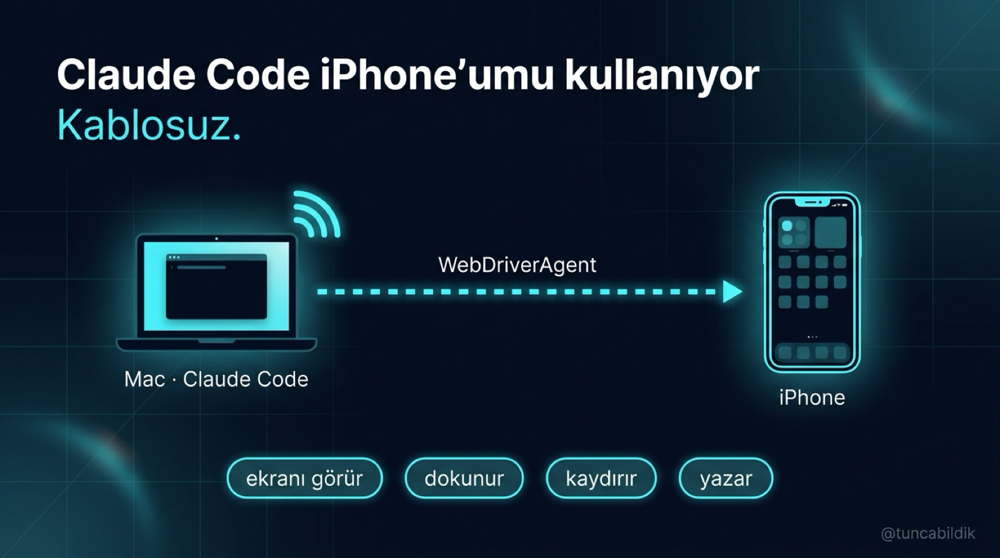
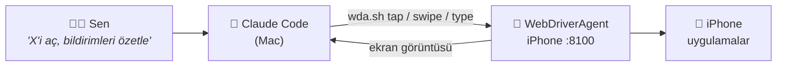

<div align="center">



# 📱 iphone-claude-code

**Claude Code'a iPhone'unu kullandır. Kablosuz.**

Ekranı görür · dokunur · kaydırır · yazar

[](#-gerekenler)
[](#-gerekenler)
[](https://claude.com/claude-code)
[](https://github.com/appium/WebDriverAgent)
[](LICENSE)

[Nasıl çalışır](#-nasıl-çalışır) · [Hızlı başlangıç](#-hızlı-başlangıç) · [Komutlar](#-komutlar) · [Claude Code'a öğret](#-claude-codea-öğret) · [Sorun giderme](#-sorun-giderme)

</div>

---

## ✨ Neler yapabilirsin

| | |
|---|---|
| 🧪 **Uygulamanı test et** | Kendi iOS uygulamanı gerçek cihazda uçtan uca gezdir, her adımın ekran görüntüsünü al |
| 🖼️ **Mağaza görselleri** | App Store için gerçek cihazdan ekran görüntüsü serisi çıkar |
| 🗂️ **Ana ekranı düzenle** | Uygulamaları klasörlere ayır, yer değiştir |
| 📰 **Oku ve özetle** | Bildirimleri, akışı, mesajları okuyup özetle |
| ⚙️ **Ayar değiştir** | Ayarlar'da bir seçeneği bul, aç/kapat |

> [!NOTE]
> Bu rehberdeki her şey gerçek bir iPhone'da denendi. Bu deponun duyurusunu yapan X profili de Claude Code tarafından, bu yöntemle düzenlendi.

---

## 🧠 Nasıl çalışır

**WebDriverAgent (WDA)**, Apple'ın XCTest altyapısı üzerine kurulu açık kaynak bir araç. Telefona küçük bir test uygulaması olarak yüklenir ve `8100` portundan HTTP ile komut alır. Claude Code bu komutları çağırır, ekran görüntüsüne bakar, bir sonraki adıma kendi karar verir.



---

## 📋 Gerekenler

- 💻 Mac + **Xcode**
- 🍎 Apple geliştirici hesabı. Ücretsiz hesapla da olur, ama imza 7 günde bir yenilenmeli.
- 🔓 iPhone'da **Geliştirici Modu** açık: *Ayarlar → Gizlilik ve Güvenlik → Geliştirici Modu*
- 📶 iPhone ve Mac aynı Wi-Fi ağında (ya da kablo)

---

## 🚀 Hızlı başlangıç

### 1️⃣ WebDriverAgent'ı indir

```bash
git clone https://github.com/appium/WebDriverAgent.git
cd WebDriverAgent
```

### 2️⃣ İmzala ve derle

Telefonun kimliğini (UDID) bul:

```bash
xcrun devicectl list devices
```

Derle:

```bash
xcodebuild build-for-testing \
  -project WebDriverAgent.xcodeproj \
  -scheme WebDriverAgentRunner \
  -destination "id=<UDID>" \
  -derivedDataPath ./derleme \
  -allowProvisioningUpdates \
  DEVELOPMENT_TEAM=<TAKIM_ID> \
  PRODUCT_BUNDLE_IDENTIFIER=com.senin.WebDriverAgentRunner
```

> [!TIP]
> `TAKIM_ID`, Apple geliştirici takım kimliğin. Bundle id'yi kendine özel bir şeyle değiştir. İmza hatası alırsan projeyi Xcode'da aç ve `WebDriverAgentRunner` hedefinde **Signing & Capabilities** bölümünden takımını seç.

### 3️⃣ Telefonda başlat

```bash
xcodebuild test-without-building \
  -xctestrun ./derleme/Build/Products/*.xctestrun \
  -destination "id=<UDID>"
```

Çıktıda telefonun adresi görünür:

```
ServerURLHere->http://192.168.x.x:8100<-ServerURLHere
```

Çalıştığını kontrol et:

```bash
curl http://<iphone-ip>:8100/status
```

> [!IMPORTANT]
> İlk seferde telefonda geliştiriciye güvenmen gerekebilir: *Ayarlar → Genel → VPN ve Cihaz Yönetimi*. Komut açık kaldığı sürece WDA çalışır.

<details>
<summary>🔌 <b>Wi-Fi yerine kabloyla bağlanmak</b></summary>

<br>

```bash
brew install libimobiledevice
iproxy 8100 8100
export WDA_URL=http://localhost:8100
```

</details>

---

## 🎮 Komutlar

Bu depodaki [`wda.sh`](wda.sh), en sık kullanılan WDA çağrılarını tek satıra indiriyor:

```bash
export WDA_URL=http://<iphone-ip>:8100
```

| Komut | Ne yapar |
|---|---|
| `./wda.sh shot ekran.png` | 📸 Ekran görüntüsü al |
| `./wda.sh tap 200 400` | 👆 (x, y) noktasına dokun |
| `./wda.sh swipe 220 780 220 230` | 👋 Kaydır (başlangıç → bitiş) |
| `./wda.sh type "Merhaba dünya"` | ⌨️ Odaktaki alana yaz (Türkçe karakterler sorunsuz) |
| `./wda.sh home` | 🏠 Ana ekrana dön |
| `./wda.sh source` | 🌳 Ekrandaki öğeler, konumlarıyla (JSON) |

> [!NOTE]
> Koordinatlar **point** cinsinden, piksel değil. iPhone Pro Max'te ekran 440×956 point. Ekran görüntüsündeki pikseli ekran ölçeğine (3x) bölerek point'e çevirirsin.

---

## 🤖 Claude Code'a öğret

Projendeki `CLAUDE.md` dosyasına ekle:

```markdown
## iPhone kontrolü
iPhone'a WebDriverAgent ile erişebilirsin: `WDA_URL=http://<iphone-ip>:8100 ./wda.sh ...`
- Her adımdan önce `shot` ile ekran görüntüsü al ve bak; körlemesine dokunma.
- Koordinatlar point cinsinden (ekran 440×956).
- Gönderi paylaşma, mesaj gönderme ve satın alma gibi geri alınamaz adımlardan önce bana sor.
```

Sonra düz Türkçe ile ne istediğini söyle:

```text
> X'i aç, bildirimlerimi oku ve özetle.
> Ana ekrandaki yapay zekâ uygulamalarını "Yapay Zekâ" klasörüne topla.
> Uygulamamın giriş ekranından ödeme ekranına kadar git, her adımın ekran görüntüsünü al.
```

---

## ⚠️ Dikkat edilecekler

| | |
|---|---|
| ✅ **Aynı sayfa** | Dokunma, yazma, aynı sayfada sürükle-bırak: çok güvenilir |
| ⚠️ **Sayfalar arası sürükleme** | Kenar beklemesi bazen bir sayfa eksik çeviriyor; her adımda ekran görüntüsü al |
| 🔐 **Face ID ve şifre** | WDA bunları geçemez, geçmemeli de. Bu adımlar sende kalır. |
| 🐢 **Hız** | Her adım yaklaşık 1 saniye; uzun otomasyonları izle |
| 💤 **Mac uyursa** | WDA da durur; 3. adımı tekrar çalıştır |

---

## 🛠️ Sorun giderme

<details>
<summary><b><code>curl .../status</code> yanıt vermiyor</b></summary>

<br>

- `xcodebuild test-without-building` komutu hâlâ açık mı?
- iPhone ve Mac aynı Wi-Fi ağında mı? Misafir ağları cihazları birbirinden yalıtabilir.
- Telefon kilitliyken WDA çalışmaya devam eder, ama ilk başlatmada kilidin açık olması iyi olur.

</details>

<details>
<summary><b>İmza / provisioning hatası</b></summary>

<br>

- `DEVELOPMENT_TEAM` doğru mu? Xcode → Settings → Accounts'tan bak.
- Bundle id başka bir uygulamayla çakışıyor olabilir; benzersiz bir şey ver.
- Ücretsiz hesapta imza 7 günde bir sona erer; 2. adımı yeniden çalıştır.

</details>

<details>
<summary><b>Dokunuş yanlış yere gidiyor</b></summary>

<br>

- Piksel değil **point** kullan: ekran görüntüsü 1320 piksel genişse ve ekran 440 point ise, 3'e böl.
- Sayfa kaydırıldıysa eski koordinatlar geçersizdir; yeni bir `shot` al.

</details>

---

<div align="center">

Hazırlayan **[@tuncabildik](https://x.com/tuncabildik)** · Beğendiysen ⭐ bırak

<sub>WebDriverAgent, <a href="https://github.com/appium/WebDriverAgent">appium/WebDriverAgent</a> projesine aittir. Bu depo yalnızca kurulum rehberi ve küçük bir yardımcı betik içerir.</sub>

</div>
